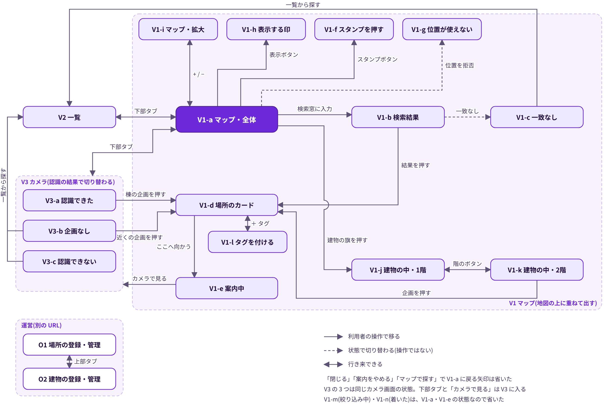
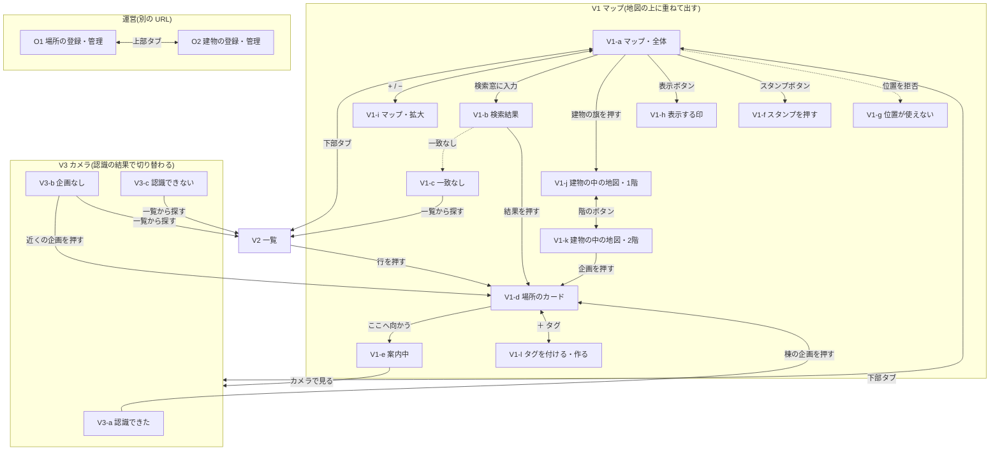

# NAsVI 画面選定

作成: 2026-11-20 / 更新: 2026-11-21(D-012〜D-014 を反映) / 状態: チームの合意前の案

- もとにした概念設計: `concept-design/concepts.yaml` と `doc/concept-design.md`(r4、main `b4cf226`)
- 画面のワイヤーフレーム: [wireframe.md](wireframe.md)(画像と付箋)。表の「ワイヤーフレーム」列の V1-a などは、ワイヤーフレームの画面の名前
- ワイヤーフレームの元のデータ: Claude の Design キャンバス(https://claude.ai/artifact/ARBxEgg7ybog3kZK7Qzpo2 )

この文書で使う記号

- **F1〜F5**: 機能(`input.yaml`)。F1 行きたい場所を見つける、F2 行き先へ向かう、F3 混雑・感想を知る、F4 種類・自分用タグから選ぶ(任意)、F5 迷いを解く(任意)。「F2 の失敗時」などは、`criteria.yaml` の評価基準を指す
- **OQ-n**: 未決事項(`open-questions.yaml`)。この文書に出てくるのは OQ-1(場所を登録する運営をどう識別するか)、OQ-2(GPS が取れないとき、現在地を手で指定する操作を入れるか)、OQ-13(自作タグの名前の決まりと上限)
- **D-nnn**: 設計の判断の記録(`decisions.yaml`)。この文書に出てくるのは D-004(地図は表現なので概念にしない)、D-012(絞り込みは検索結果にも効かせる)、D-013(行き先は場所のカードの「ここへ向かう」で決める)、D-014(自分用のタグは「行きたい場所」「お気に入り」と自作。保存は各自の端末の中)
- **同期**: 概念どうしをつなぐ規則(`concepts.yaml` の syncs)。search-places などは同期の名前
- **※**: 概念設計の変更が要る所。1 章の後半の表にまとめた(決めるのはチーム)

## 1. 概念の一覧

概念設計にある 7 つの概念と、利用者がそれに対して行う操作。かっこ内は、外から呼ぶ要求(`Request.*`)の名前。

| 概念 | 目的 | 来場者が行う操作 | 運営が行う操作 |
|---|---|---|---|
| Place(場所) | 運営が登録した場所(企画・駐車場)を、来場者が知る | 場所の一覧と位置を見る(showPlaces)、1 件の情報を見る | 場所を登録・編集・削除する(registerPlace・updatePlace・removePlace) |
| Search(検索) | 名前の一部から、目当ての場所を見つける | 名前の一部で探す(search)、文章で探す(searchNatural、拡張)。絞り込み中は、結果も絞る(D-012) | なし(場所を登録すると、自動で検索の対象に入る) |
| Labeling(種類・自分用タグ) | 種類や自分用のタグで絞って選ぶ | 種類やタグで絞る・解除する(applyFilter・clearFilter・browse)、「行きたい場所」「お気に入り」・自作のタグを付ける・外す(markPlace・unmarkPlace)、自作のタグを作る(defineMyTag)。タグは各自の端末の中に保存し、API には載せない(D-014) | 種類を定める・場所に付ける(defineLabel・assignLabel) |
| Position(現在地) | 自分がいま会場のどこにいるかを知る | 位置の利用を許可・拒否する(allowLocation・refuseLocation)、手で現在地を指定する(setPosition、OQ-2)。現在地の更新(reportPosition)は端末が自動で行う | なし |
| Destination(行き先) | 向かう先を 1 つ決め、方角と距離の案内を受ける | 行き先を決める(chooseDestination)、案内を見る(showRoute)、案内をやめる(※) | なし |
| Stamp(スタンプ) | 足元にスタンプを押して混雑や感想を共有し、他の人がそれを見て場所を選ぶ | スタンプを押す(pressStamp)、取り消す(retractStamp)、地図で見る(showStamps) | なし |
| Landmark(建物) | いま見ている建物がどれかを知り、迷いを解く | 建物を映して、名前と棟の企画を知る(recognizeBuilding・showBuildingEvents) | 建物と基準画像を登録・編集・削除する(registerLandmark・updateLandmark・removeLandmark) |

### 概念設計に足りないもの(※)

画面を作る中で必要になったが、概念設計にはまだ無いもの。

| 足りないもの | 使う画面 | 概念設計で要る変更 |
|---|---|---|
| 設備(案内所・トイレ・休憩所・ゴミ箱)の印 | V1 マップ、表示する印 | Place.kind に設備の種類を足す |
| 建物の中の地図と、階の切り替え | 建物の中の地図、O1、O2 | Place に「建物と階」を持たせる。階ごとの見取り図は、目的が Place とも Landmark とも違うので、新しい概念の候補 |
| 案内をやめる | 案内中 | 来場者が Destination.clear を呼ぶ同期を足す(いまは、場所を削除したときの連動からしか呼ばれない) |
| 検索結果の絞り込み(D-012) | 検索結果、一致なし | 同期 search-places の where に、絞り込み(Labeling.filtering)を入れる(#17) |
| 自分用のタグの端末内保存と、最初からある 2 つのタグ(D-014) | 場所のカード、タグを付ける・作る、V2 一覧 | Labeling.owner を残すか外すか。「行きたい場所」「お気に入り」を初期のラベルとしてどう表すか(defineMyTag は自作の分だけになる)(#17) |

なお、地図に表示する印の切り替え(チェック)は画面の中の見せ方なので、概念設計の変更は要らない(端末の中に保存する)。

## 2. 画面一覧

来場者は、下部タブで一覧(V2)・マップ(V1)・カメラ(V3)を切り替える。V1 マップの上には、カードやシートを重ねて出す(画面全体は切り替えない)。運営の画面(O1・O2)は、来場者とは別の URL にする。

| 画面 | 主役の概念 | 一緒に表示する概念 | できる操作 | まとめた/分けた理由 | ワイヤーフレーム |
|---|---|---|---|---|---|
| **V1 マップ(ホーム)** | Place(場所の位置) | Position、Stamp、Labeling(絞り込み)、Search(検索窓)、設備の印 ※ | 地図を見る、拡大・縮小する、種類や自分用のタグで絞る、検索窓に入力する、建物の旗を押す、スタンプボタンを押す、現在地へ移動する | 位置を持つ概念は、どれも地図に重ねて描ける(D-004)。F2(行き先を決めたら、追加の操作なしで方角と距離が出る)、F3(スタンプは 2 操作以内)、F4(絞ると地図の印も絞られる)を満たすため、1 つの画面にまとめた。全体と拡大は同じ画面の見せ方の違いで、屋外の企画の名前とスタンプの文字は、拡大したときだけ出す。絞り込み中は、一覧・検索結果と同じ帯を出す | V1-a、V1-i、V1-m |
| └ 検索結果(V1 に重ねる) | Search | Place(名前・場所・距離)、Labeling(絞り込み中の表示 ※) | 名前の一部で探す、結果を押してカードを開く、絞り込みを解除する、一致しないときは別の言葉で探すか一覧へ移る | 同期 search-places は Search と Place を同時に読むので、同じ所に出す。結果から場所のカードまで画面を変えずに進めるよう、地図の上に重ねた。絞り込み中は検索結果も絞る(D-012)ので、帯でそのことを示し、解除できるようにした。一致しないとき(F1 の失敗時)も、同じ場所で次の手を示す | V1-b、V1-c |
| └ 場所のカード(V1 に重ねる) | Place(1 件) | Destination、Labeling(行きたい場所・お気に入り) | 場所の情報を見る、ここへ向かう、行きたい場所・お気に入りを付ける・外す、タグの画面を開く | 行き先にする・タグを付けるは、どちらも 1 つの場所に対する操作なので、同じカードにまとめた。場所の位置は地図の上で意味を持つので、地図に重ねる。カードを開いただけでは行き先にせず、「ここへ向かう」で決める(D-013)。見るだけ(F1)と向かう(F2)を分けるため | V1-d |
| └ タグを付ける・作る(V1 に重ねる) | Labeling(自分用のタグ)※ | Place(1 件) | タグを付ける・外す、新しいタグを作る | タグは 1 つの場所に付けるので、場所のカードの「＋ タグ」から開く。自作のタグは名前を入れる欄が要るので、カードとは別のシートにした。タグは端末の中にだけ保存する(D-014)ので、消えることがあると、ここで伝える。名前の決まりと上限は未決(OQ-13) | V1-l |
| └ 案内中(V1 に重ねる) | Destination | Position、Place | 方角・距離・更新時刻を見る、カメラで見る、案内をやめる ※、着いたら案内を終える | 同期 guide-on-move は Position・Destination・Place を同時に読む。F2(追加の操作なしで位置関係が分かる)を満たすため、別の画面に移さず、カードをそのまま案内の表示に切り替える。行き先の近くに来たら、同じカードを「着きました」に変え、F2 の終わりが分かるようにする | V1-e、V1-n |
| └ スタンプを押す(V1 に重ねる) | Stamp | Position | 混雑 1〜5 か、感想 3 種類のどれかを押す、取り消す | 同期 press-stamp は Position の現在地を使う。F3(2 操作以内)を満たすため、スタンプボタン → 種類 の 2 操作で押せるシートにした | V1-f |
| └ 位置が使えない(V1 の状態) | Position | なし | 位置の利用を許可する、地図で現在地を指定する(OQ-2) | 位置の許可・拒否は端末の許可の結果なので、別の画面にはしない。F2 の失敗時の扱い(できなくなることと、代わりにできること)を、地図の上の帯で示す | V1-g |
| └ 表示する印(V1 に重ねる) | なし(見せ方の設定) | Place(企画・駐車場・設備 ※)、Stamp(混雑・感想) | 地図に出す印をチェックで選ぶ、すべて表示する | どの概念の状態も変えない見せ方の設定なので、概念にはしない。Labeling の絞り込みは場所を選ぶための機能で、目的が違う。そのため、上のチップ列とは別のパネルに分けた | V1-h |
| └ 建物の中の地図(V1 に重ねる) | Place(建物と階で絞る)※ | 階ごとの見取り図 ※ | 階を切り替える(最初は 1 階)、企画を押してカードを開く | 屋内の企画の名前は、建物を開いたときに初めて出す。階の切り替えは 1 つの建物の中の操作なので、建物ごとのシートにまとめた | V1-j、V1-k |
| **V2 一覧** | Place(名前と種別) | Labeling(種類やタグで選ぶ・絞り込み・行きたい場所・お気に入り)、Search(検索窓) | 種類やタグで絞る、名前で探す、行きたい場所・お気に入りを付ける、行を押してカードを開く | 概念は V1 の一部なので、統合もできる。それでも分けたのは、評価基準が一覧を求めているため(F1・F5 の失敗時に「一覧から探す」、F4 で「種類を選ぶと一覧が出る」)。地図を見ずに、名前や種類で選ぶ人の入口になる。絞り込みの状態は V1 と共有する | V2 |
| **V3 カメラ** | Landmark | Place(棟の企画)、Destination(案内バー)、Position | 建物を映す、棟の企画を押す、一覧かマップへ移る | 入力が映像で、画面全体を使う。映像は端末の中で処理し、保存も送信もしない。F5 は任意の機能なので、外すときに画面ごと外せるよう分けた。案内バーを重ねれば、カメラで向かう道案内も兼ねる | V3-a、V3-b、V3-c |
| **O1 場所の登録・管理**(運営) | Place | Labeling(種類)、建物と階 ※ | 場所を登録・編集・削除する、種類を定める・付ける | 実行者が運営なので(同期の条件「実行者が場所を管理できる」、OQ-1)、来場者の画面と分けた。種類は場所を登録するときに付けるので、同じ画面にした。検索への登録は同期が自動で行うので、画面は要らない | O1 |
| **O2 建物の登録・管理**(運営) | Landmark | 階ごとの見取り図 ※ | 建物と基準画像を登録・編集・削除する、階の見取り図を登録する | O1 と同じ運営の操作だが、基準画像という別のデータを扱う。F5 を外すときに外しやすいよう、O1 と分けた | O2 |

## 3. 画面遷移図

拡大して見るときは `screen-transitions.svg` を開く。

- 実線の矢印は利用者の操作で移るもの、点線は操作ではなく状態で切り替わるもの、両向きの矢印は行き来できるもの
- 「閉じる」「案内をやめる」「マップで探す」で V1-a に戻る矢印は省いた
- V3-a・V3-b・V3-c は、同じカメラ画面の状態。下部タブと「カメラで見る」は V3 に入る
- V1-m(マップ・絞り込み中)と V1-n(行き先に着いた)は、V1-a・V1-e の状態の違いなので、図では省いた

下は、同じ遷移を Mermaid で書いたもの(GitHub などで図として表示でき、文字で直せる)。

