# NAsVI ワイヤーフレーム

状態: チームの合意前の案 / 書き出し: 2026-11-20

- 画面の選び方(概念の一覧・画面一覧・画面遷移図)は [screen-selection.md](screen-selection.md)
- 元のデータは Claude の Design キャンバス(https://claude.ai/artifact/ARBxEgg7ybog3kZK7Qzpo2 )。このページの画像は、そこから書き出したもの。直すときはキャンバスを直し、画像を書き出し直す
- 来場者はスマートフォンの縦持ち(390×844)、運営は PC。地図の建物の形は © OpenStreetMap contributors(ODbL)
- 各画像の下の文は、キャンバスの付箋と同じ。引用(左に線)の文は要確認と、概念設計の変更が要る所(※)。記号(F1〜F5・OQ-n・D-nnn・同期・※)の意味は、下の凡例の画像にある

## 目次

- 凡例
- 来場者 V1 マップ(ホーム): V1-a マップ・全体、V1-b 検索結果、V1-c 一致なし、V1-d 場所のカード、V1-e 案内中、V1-f スタンプを押す、V1-g 位置が使えない、V1-h 表示する印、V1-i マップ・拡大、V1-j 建物の中の地図・1階、V1-k 建物の中の地図・2階
- 来場者 V2 一覧・V3 カメラ: V2 一覧(種類で絞り込み中)、V3-a カメラ・認識できた、V3-b カメラ・企画なし、V3-c カメラ・認識できない
- 運営(PC): O1 場所の登録・管理(運営・PC)、O2 建物の登録・管理(運営・PC)
- ライト配色・色の例・共通の地図: ライト V1-a マップ・全体、ライト V1-h 表示する印、色の例(ダーク・ライト)、部品: 会場の地図(共通)

## 凡例

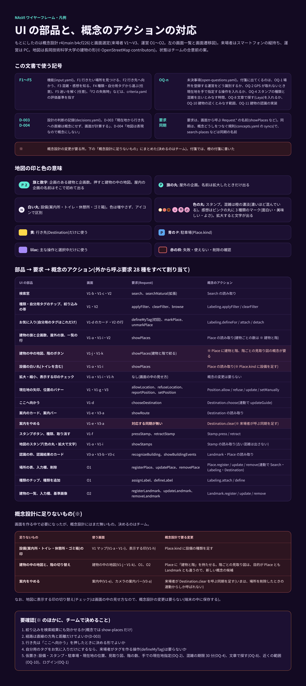

## 来場者 V1 マップ(ホーム)

### V1-a マップ・全体

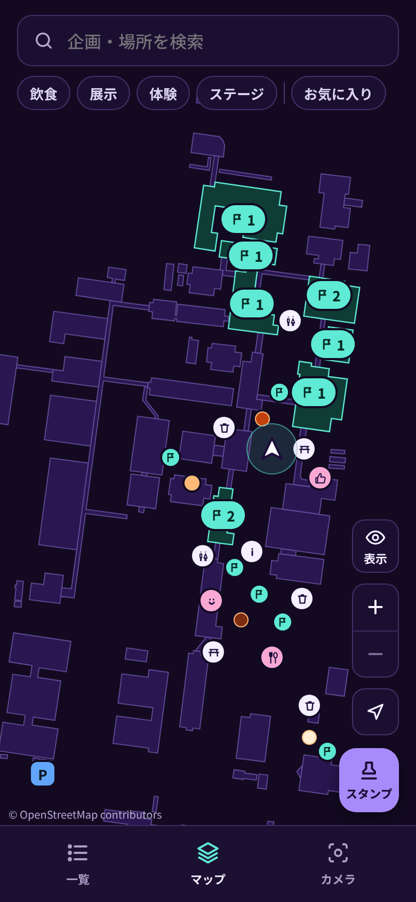

**V1-a マップ・全体(画面一覧の「V1 マップ」)**

- **主役**: Place(場所の位置)
- **一緒に表示**: Position、Stamp、Labeling(絞り込み)、Search(検索窓)、設備の印 ※
- **操作**: 地図を見る、拡大・縮小する、種類やお気に入りで絞る、検索窓に入力する、建物の旗を押す、スタンプボタンを押す、現在地へ移動する
- **理由**: 位置を持つ概念は、どれも地図に重ねて描ける(D-004)。F2(行き先を決めたら、追加の操作なしで方角と距離が出る)、F3(スタンプは 2 操作以内)、F4(絞ると地図の印も絞られる)を満たすため、1 つの画面にまとめた
- **要求**: showPlaces、showStamps、reportPosition
- 建物の形は長岡技術科学大学の OpenStreetMap(出典を画面に表示)
- 企画のある建物に旗と企画数。押すと建物の中の地図(V1-j)
- スタンプは色の丸(混雑は橙の濃淡、感想は 3 種類のマーク)
- 設備(案内所・トイレ・休憩所・ゴミ箱)は白い丸。位置は仮

### V1-b 検索結果

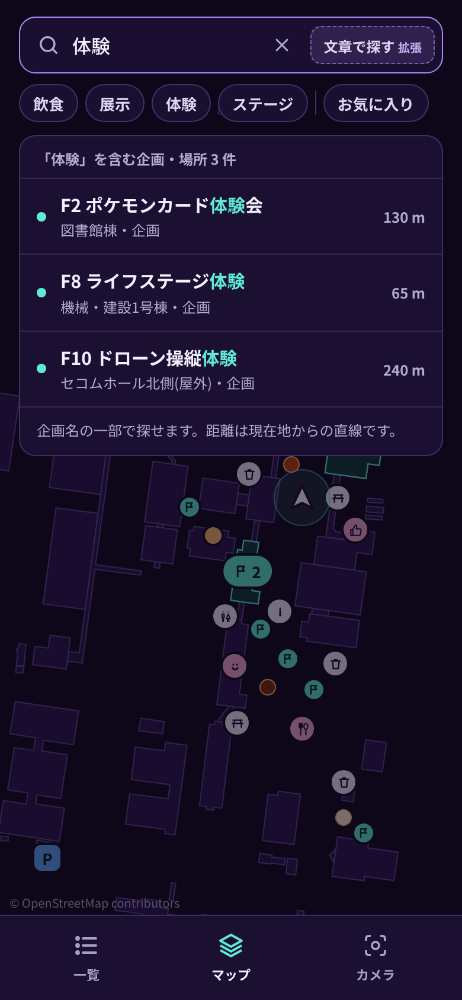

**V1-b 検索結果(V1 に重ねる)**

- **主役**: Search
- **一緒に表示**: Place(名前・場所・距離)
- **操作**: 名前の一部で探す、結果を押してカードを開く、一致しないときは別の言葉で探すか一覧へ移る
- **理由**: 同期 search-places は Search と Place を同時に読むので、同じ所に出す。結果から場所のカードまで画面を変えずに進めるよう、地図の上に重ねた
- **要求**: search
- 入力のたびに、検索窓の下に結果。企画名・場所・直線距離
- 結果を押すと V1-d のカードへ
- 「文章で探す」(searchNatural)は Laya の拡張(OQ-8)

> **要確認: 絞り込み中に、検索結果も絞るか。概念設計では、絞り込みは show-places にだけ効く**

### V1-c 一致なし

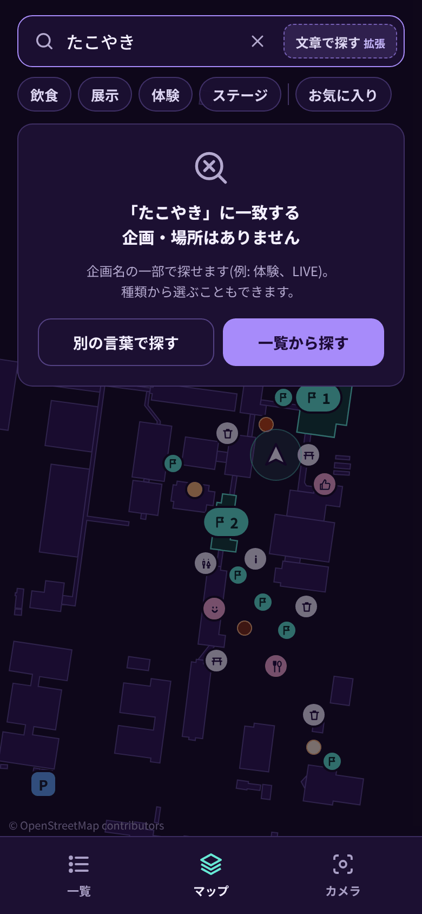

**V1-c 一致なし(主役・一緒に表示・操作は V1-b と同じ)**

- **理由**: 一致しないとき(F1 の失敗時)も、同じ場所で次の手を示す
- 何も出さないのではなく、一致が無いことを出す
- 「別の言葉で探す」: 入力を消して打ち直す
- 「一覧から探す」: V2 へ

### V1-d 場所のカード

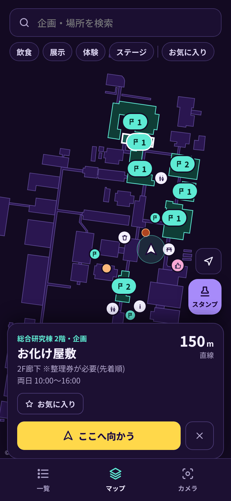

**V1-d 場所のカード(V1 に重ねる)**

- **主役**: Place(1 件)
- **一緒に表示**: Destination、Labeling(お気に入り)
- **操作**: 場所の情報を見る、ここへ向かう、お気に入りを付ける・外す
- **理由**: 行き先にする・お気に入りにするは、どちらも 1 つの場所に対する操作なので、同じカードにまとめた。場所の位置は地図の上で意味を持つので、地図に重ねる。カードを開いただけでは行き先にせず、見るだけ(F1)と向かう(F2)を分けた
- **要求**: chooseDestination、markPlace / unmarkPlace(初めて付けるときは defineMyTag も)
- 検索結果、一覧、建物の中の地図(V1-k)、カメラ(V3)から開く
- お気に入りは押すと切り替わる。他の来場者には見えない

> **要確認: カードを開いただけでは行き先にせず、「ここへ向かう」を押したときに行き先にする形でよいか**

### V1-e 案内中

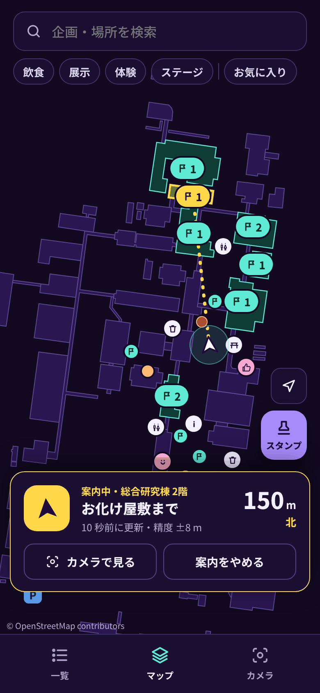

**V1-e 案内中(V1 に重ねる)**

- **主役**: Destination
- **一緒に表示**: Position、Place
- **操作**: 方角・距離・更新時刻を見る、カメラで見る、案内をやめる ※
- **理由**: 同期 guide-on-move は Position・Destination・Place を同時に読む。F2(追加の操作なしで位置関係が分かる)を満たすため、別の画面に移さず、カードをそのまま案内の表示に切り替える
- **要求**: showRoute
- 現在地から行き先へは直線の点線(D-003。道なりの経路は作らない)
- 更新時刻を出す(F2: 古いかが分かる)

> **※ 概念設計に足りないもの: 案内をやめる**
> - **要る変更**: 来場者が Destination.clear を呼ぶ同期を足す(いまは、場所を削除したときの連動からしか呼ばれない)。決めるのはチーム

### V1-f スタンプを押す

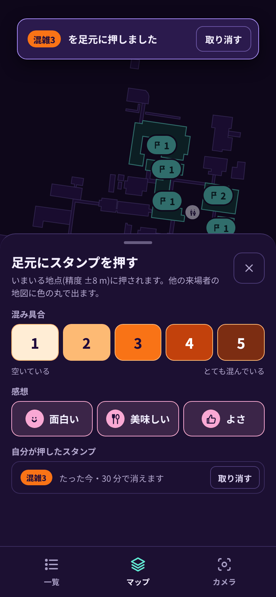

**V1-f スタンプを押す(V1 に重ねる)**

- **主役**: Stamp
- **一緒に表示**: Position
- **操作**: 混雑 1〜5 か、感想 3 種類のどれかを押す、取り消す
- **理由**: 同期 press-stamp は Position の現在地を使う。F3(2 操作以内)を満たすため、スタンプボタン → 種類 の 2 操作で押せるシートにした
- **要求**: pressStamp、retractStamp
- 送ったあと、通知から取り消せる
- 混雑 1〜5 は橙の濃淡と数字。感想は 3 種類のマーク(面白い・美味しい・よさ)で、地図の丸と同じマーク
- 現在地が無いときは種類を薄くし、許可か手での指定を案内(F3 の失敗時)
- 混雑を古いとみなす時間は OQ-4(ワイヤーフレームでは 30 分で仮置き)

### V1-g 位置が使えない

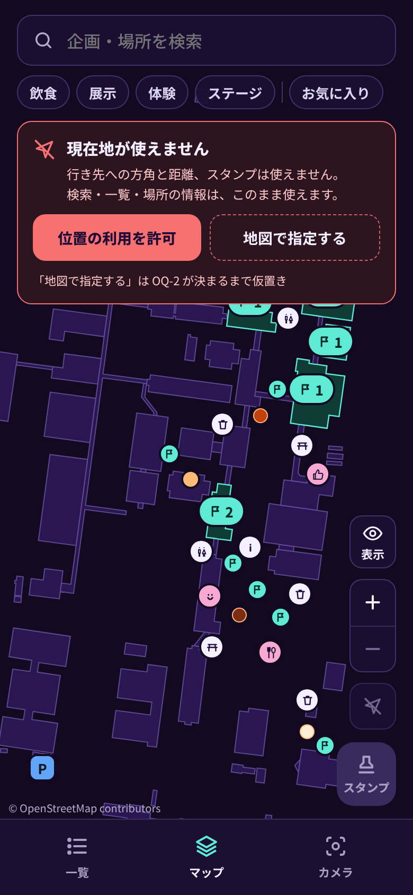

**V1-g 位置が使えない(V1 の状態)**

- **主役**: Position
- **一緒に表示**: なし
- **操作**: 位置の利用を許可する、地図で現在地を指定する(OQ-2)
- **理由**: 位置の許可・拒否は端末の許可の結果なので、別の画面にはしない。F2 の失敗時の扱い(できなくなることと、代わりにできること)を、地図の上の帯で示す
- **要求**: allowLocation / refuseLocation、setPosition
- できなくなること(方角・距離、スタンプ)と、できること(検索・一覧)を出す
- 「地図で指定」は OQ-2 が決まるまで仮置き

### V1-h 表示する印

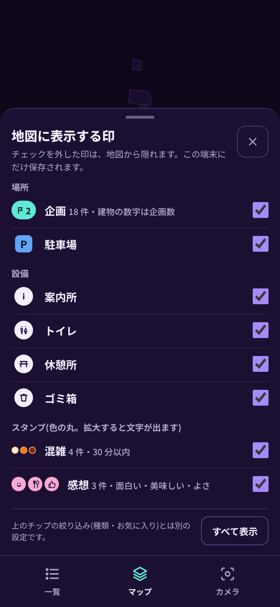

**V1-h 表示する印(V1 に重ねる)**

- **主役**: なし(見せ方の設定)
- **一緒に表示**: Place(企画・駐車場・設備 ※)、Stamp(混雑・感想)
- **操作**: 地図に出す印をチェックで選ぶ、すべて表示する
- **理由**: どの概念の状態も変えない見せ方の設定なので、概念にはしない。Labeling の絞り込みは場所を選ぶための機能で、目的が違う。そのため、上のチップ列とは別のパネルに分けた
- **要求**: なし(チェックは端末の中に保存する)
- スタンプは件数を出し、隠していてもあることが分かる
- 既定はすべて表示。チェックは実際に切り替わる

> **※ 概念設計に足りないもの: 設備(案内所・トイレ・休憩所・ゴミ箱)の印**
> - **要る変更**: Place.kind に設備の種類を足す
> - あわせて、機能(F1 を広げるか、任意の F6 を新設)と、同期 show-building-events / show-no-events の条件(種別が企画の場所だけ)を直し、判断を decisions.yaml に残す
> - モックのデータの「受付・案内所」は、いまは企画として登録されている
> - 決めるのはチーム

### V1-i マップ・拡大

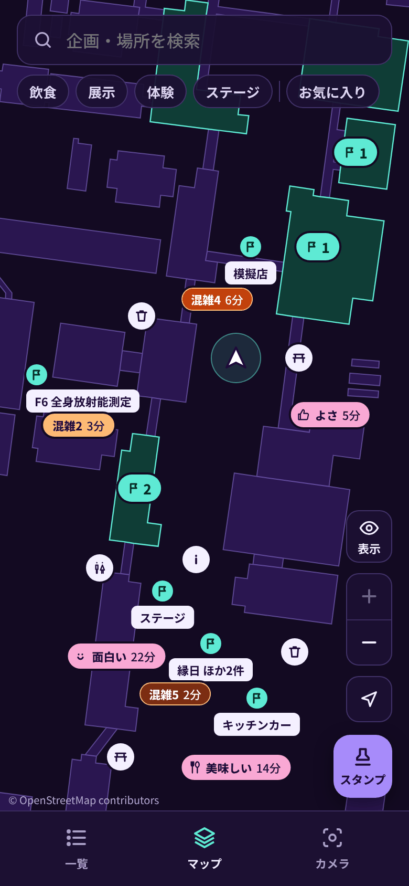

**V1-i マップ・拡大(主役・一緒に表示・操作は V1-a と同じ)**

- **理由**: 全体と拡大は同じ画面の見せ方の違いで、屋外の企画の名前とスタンプの文字は、拡大したときだけ出す
- + で拡大すると、屋外の企画の名前と、スタンプの種類・経過時間が出る。− で全体(V1-a)に戻る
- 屋内の企画の名前は出さない。建物のアイコンを押すと見える(V1-j)
- 拡大で名前を出すのは見せ方なので、概念の変更は要らない

### V1-j 建物の中の地図・1階

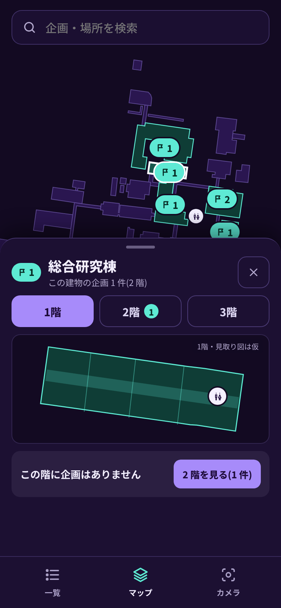

**V1-j 建物の中の地図・1階(V1 に重ねる)**

- **主役**: Place(建物と階で絞る)※
- **一緒に表示**: 階ごとの見取り図 ※
- **操作**: 階を切り替える(最初は 1 階)、企画を押してカードを開く
- **理由**: 屋内の企画の名前は、建物を開いたときに初めて出す。階の切り替えは 1 つの建物の中の操作なので、建物ごとのシートにまとめた
- **要求**: showPlaces(建物と階で絞る)
- 建物のアイコンを押すと開く。企画のある階のボタンには件数を出す
- この建物の企画はお化け屋敷(2F 廊下)だけなので、1 階は「この階に企画はありません」と 2 階への案内
- 見取り図とトイレの位置は仮。階のボタンは実際に切り替わる

> **※ 概念設計に足りないもの: 建物の中の地図と、階の切り替え(使う画面: V1-j・V1-k、O1、O2)**
> - **要る変更**: Place に「建物と階」を持たせる。階ごとの見取り図は、目的(建物の中のどこに何があるかを知る)が Place とも Landmark とも違うので、新しい概念の候補
> - 建物ごとの企画数は、「建物と階」があれば同期の where で数えられる
> - 決めるのはチーム

### V1-k 建物の中の地図・2階

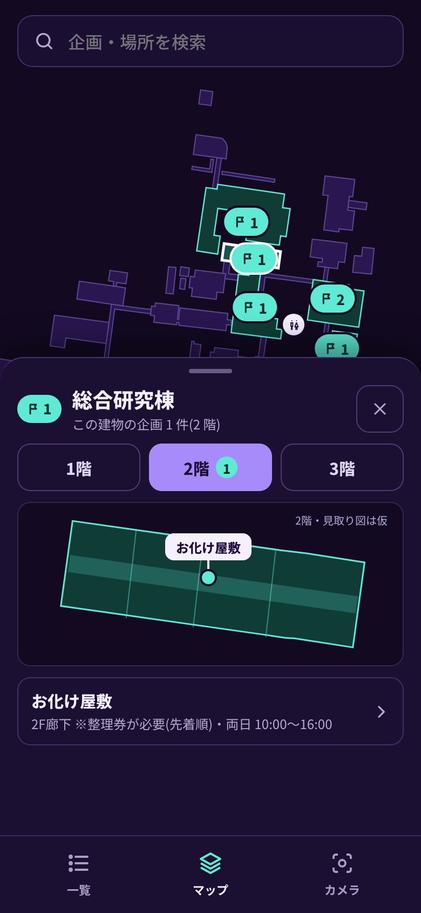

**V1-k 建物の中の地図・2階(主役・一緒に表示・操作は V1-j と同じ)**

- 屋内の企画の名前は、建物を開いたときに初めて出る
- 見取り図の印か一覧の行を押すと、場所のカード(V1-d)へ

## 来場者 V2 一覧・V3 カメラ

### V2 一覧(種類で絞り込み中)

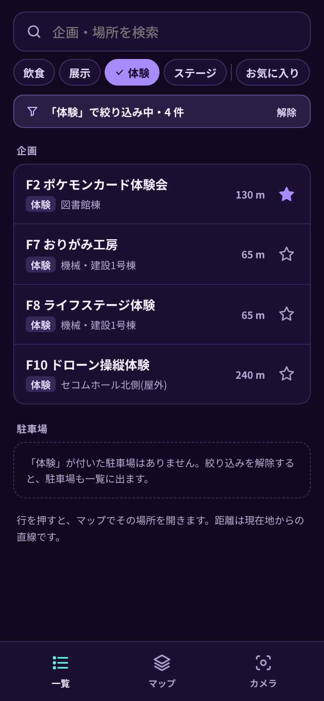

**V2 一覧(下部タブ)**

- **主役**: Place(名前と種別)
- **一緒に表示**: Labeling(種類で選ぶ・絞り込み・お気に入り)、Search(検索窓)
- **操作**: 種類で絞る、名前で探す、お気に入りを付ける、行を押してカードを開く
- **理由**: 概念は V1 の一部なので、統合もできる。それでも分けたのは、評価基準が一覧を求めているため(F1・F5 の失敗時に「一覧から探す」、F4 で「種類を選ぶと一覧が出る」)。地図を見ずに、名前や種類で選ぶ人の入口になる。絞り込みの状態は V1 と共有する
- **要求**: showPlaces、browse、applyFilter / clearFilter、markPlace
- 種類のチップを 1 回押すと、その種類の一覧(F4: 1 操作)
- 絞り込み中は帯と件数で分かる(F4)
- 空なら「この種類の場所はありません」と解除(F4 の失敗時)

### V3-a カメラ・認識できた

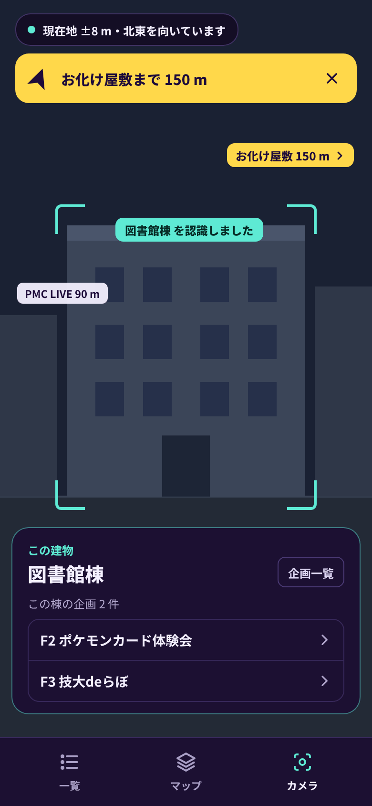

**V3-a カメラ・認識できた(下部タブ)**

- **主役**: Landmark
- **一緒に表示**: Place(棟の企画)、Destination(案内バー)、Position
- **操作**: 建物を映す、棟の企画を押す、一覧かマップへ移る
- **理由**: 入力が映像で、画面全体を使う。映像は端末の中で処理し、保存も送信もしない。F5 は任意の機能なので、外すときに画面ごと外せるよう分けた。案内バーを重ねれば、カメラで向かう道案内も兼ねる
- **要求**: recognizeBuilding、showBuildingEvents、showRoute
- 映像を扱うことは、初回の説明画面で伝える
- 認識の目安は 2 秒以内(F5)
- 棟の企画を押すと V1-d へ

### V3-b カメラ・企画なし

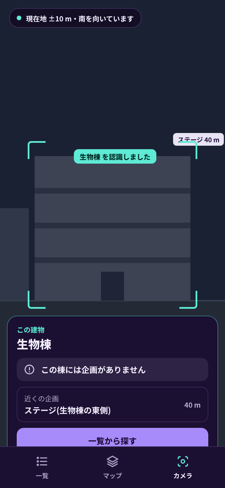

**V3-b 企画なし(V3 カメラの状態。主役・一緒に表示・操作は V3-a と同じ)**

- **要求**: showBuildingEvents(同期 show-no-events)
- 建物は分かったが企画が無い、をはっきり出す(F5)
- 「近くの企画」の範囲 near は OQ-10

### V3-c カメラ・認識できない

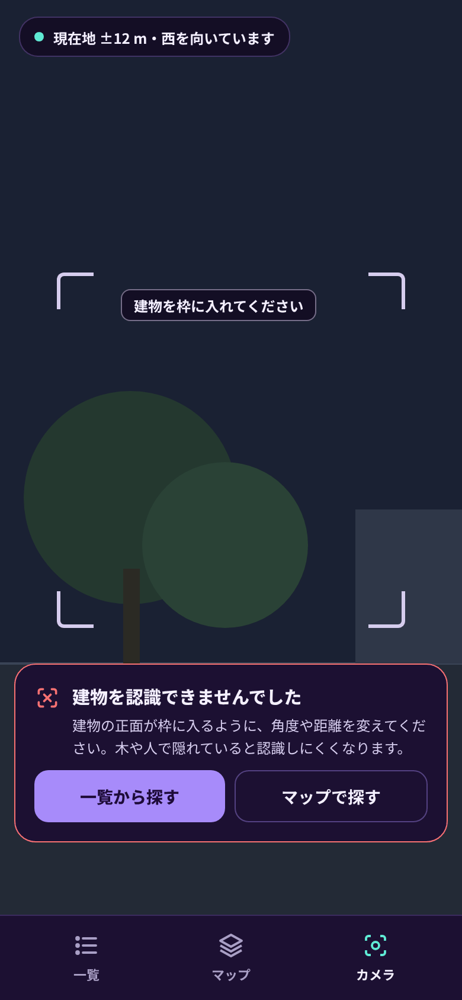

**V3-c 認識できない(V3 カメラの状態)**

- F5 の失敗時の扱い: 認識できなかったことと、次の手(角度・距離を変える、一覧から探す)を出す
- F5 を外すときは画面ごと外せる。カメラの道案内を残すなら、認識カードと枠だけを外す

## 運営(PC)

### O1 場所の登録・管理(運営・PC)

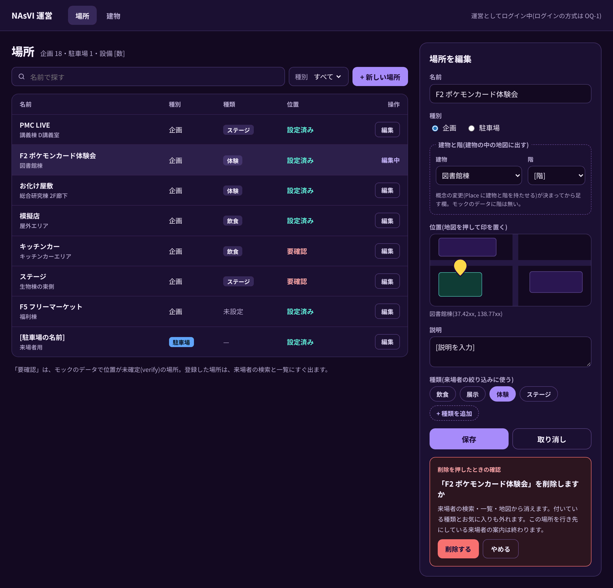

**O1 場所の登録・管理(運営・PC)**

- **主役**: Place
- **一緒に表示**: Labeling(種類)、建物と階 ※
- **操作**: 場所を登録・編集・削除する、種類を定める・付ける
- **理由**: 実行者が運営なので(同期の条件「実行者が場所を管理できる」、OQ-1)、来場者の画面と分けた。種類は場所を登録するときに付けるので、同じ画面にした。検索への登録は同期が自動で行うので、画面は要らない
- **要求**: registerPlace / updatePlace / removePlace、defineLabel / assignLabel
- 登録すると検索にも出る(同期 index-on-register)
- 削除の確認で、連動して起きること(検索・一覧から消える、行き先にしている人の案内が終わる)を先に見せる
- 建物と階の欄は、※ が決まってから
- ログインの有無は OQ-1

### O2 建物の登録・管理(運営・PC)

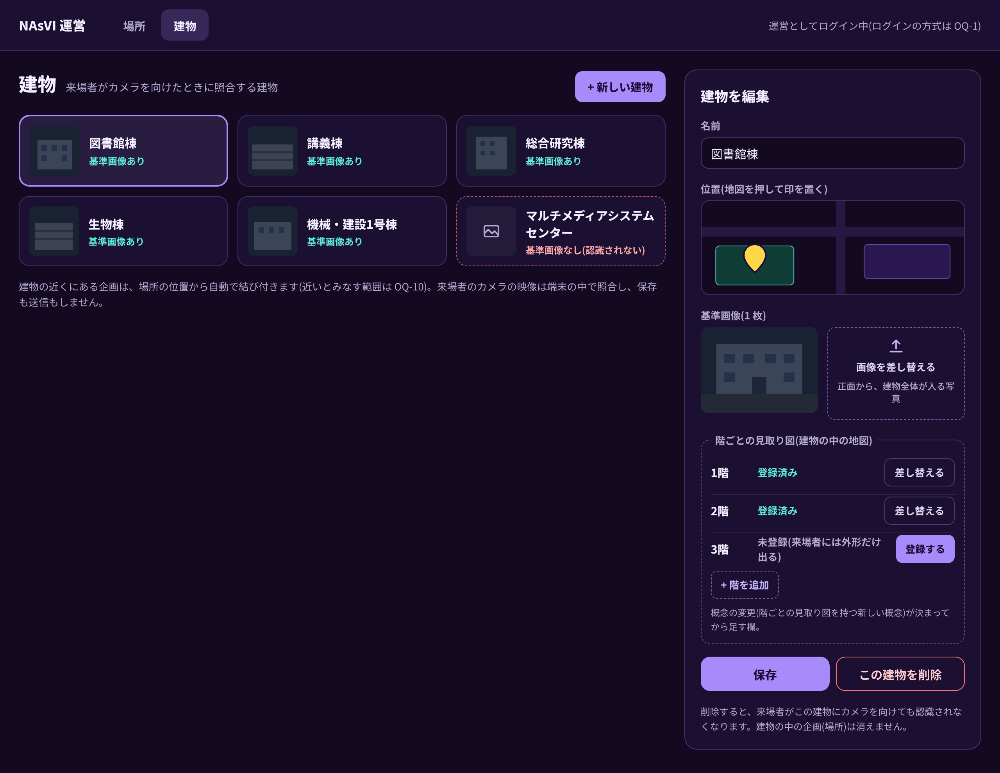

**O2 建物の登録・管理(運営・PC)**

- **主役**: Landmark
- **一緒に表示**: 階ごとの見取り図 ※
- **操作**: 建物と基準画像を登録・編集・削除する、階の見取り図を登録する
- **理由**: O1 と同じ運営の操作だが、基準画像という別のデータを扱う。F5 を外すときに外しやすいよう、O1 と分けた
- **要求**: registerLandmark / updateLandmark / removeLandmark
- 基準画像は 1 建物に 1 枚(概念の image: one Image)
- 階ごとの見取り図の欄は、※ が決まってから
- 認識の実装は OQ-11

## ライト配色・色の例・共通の地図

### ライト V1-a マップ・全体

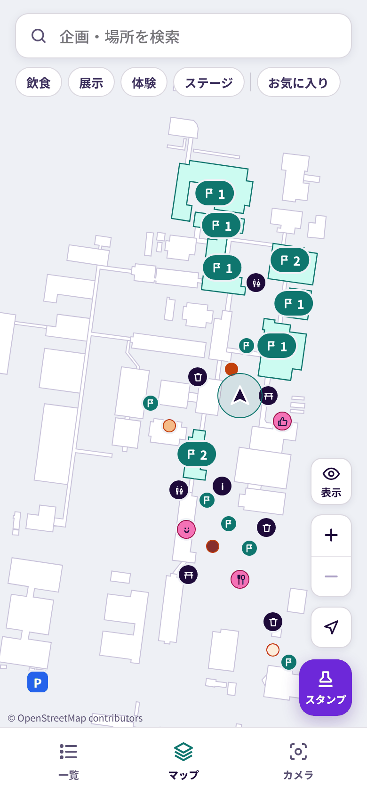

**ライト V1-a マップ・全体**

- 昼の屋外の日なた向けの比較用。実機で見比べる
- 行き先の黄は背景と明るさが近いので、濃い枠を付ける
- 混雑はダークと同じく、濃いほど混んでいる

### ライト V1-h 表示する印

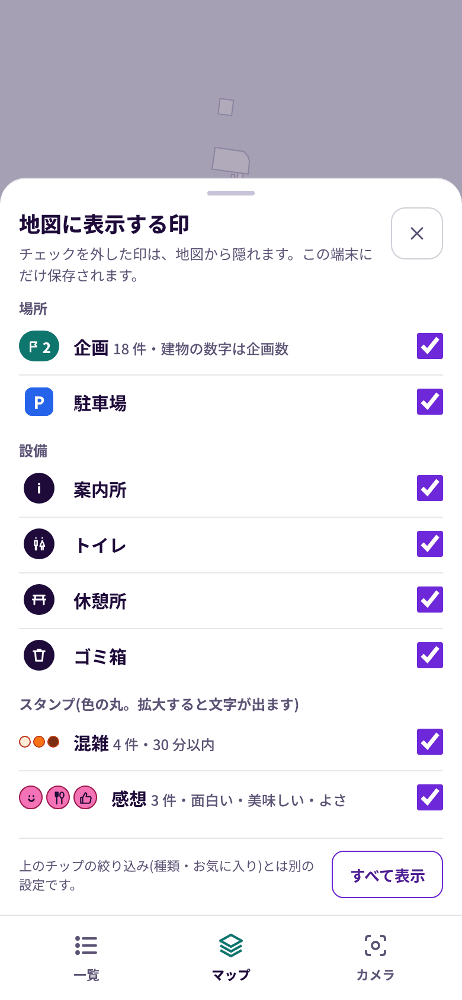

**ライト V1-h 表示する印**

- ダークと同じ構成で、色だけが違う

### 色の例(ダーク・ライト)

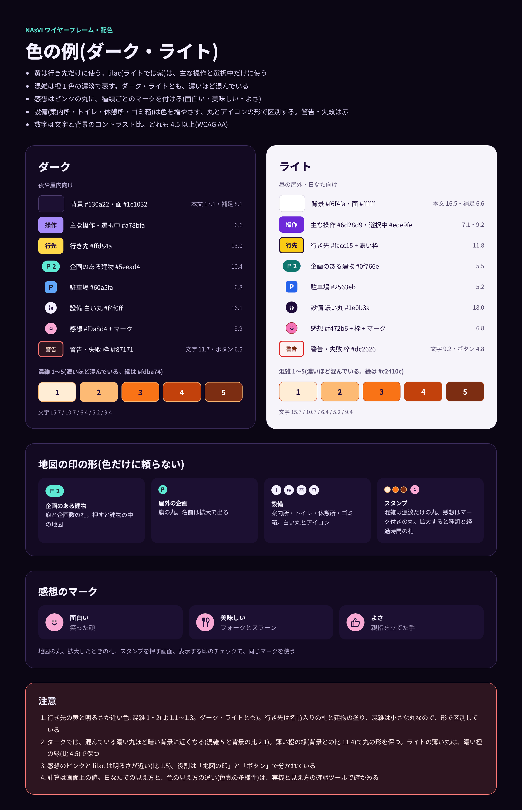

### 部品: 会場の地図(共通)

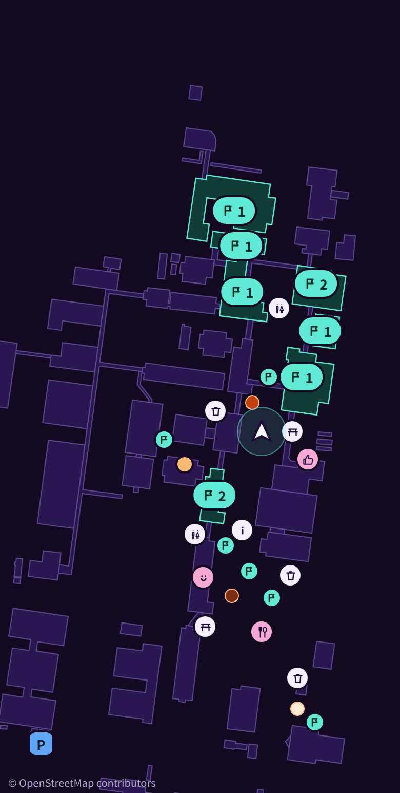

**部品: 会場の地図(共通)**

- 地図のある画面は、すべてこの部品を読み込む。全体・拡大、ダーク・ライト、選んだ建物・行き先を切り替える
- 建物の形は OpenStreetMap(© OpenStreetMap contributors、ODbL)。チームの ar-guide/data/buildings.json から変換
- 企画の位置はモックのデータ。設備・スタンプ・駐車場・現在地の位置は仮
